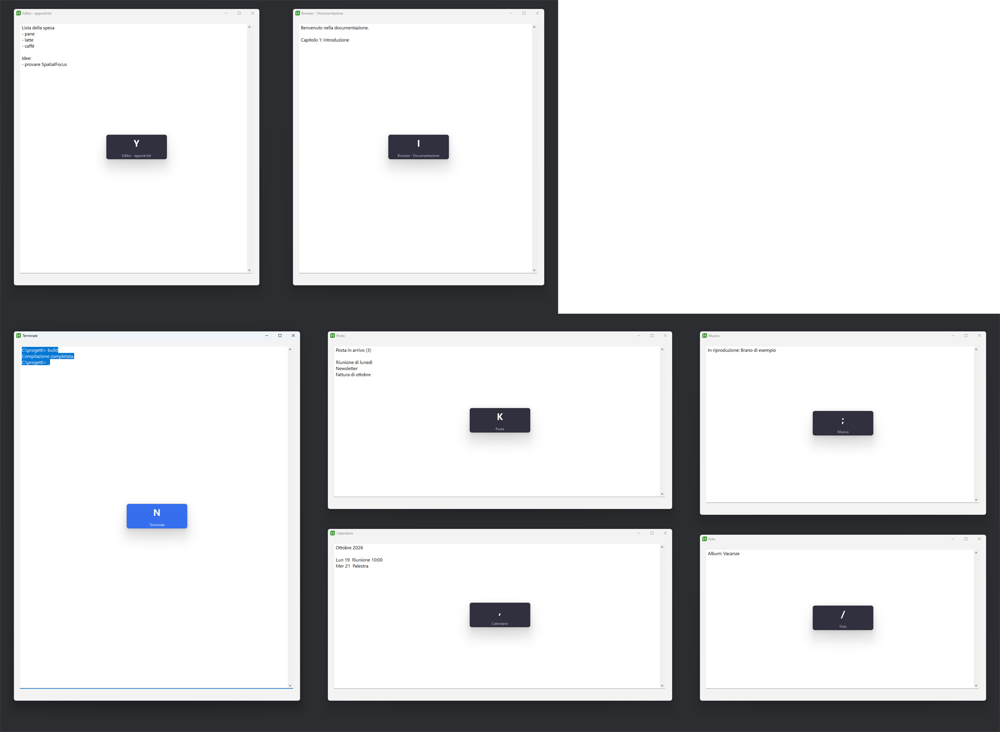

# SpatialFocus

Cambia finestra su Windows senza mouse e senza Alt+Tab. Tieni premuto **CapsLock** con la mano sinistra: su ogni finestra aperta compare una lettera, presa dalla metà destra della tastiera nella stessa posizione in cui la finestra si trova sullo schermo. Premi quella lettera con la destra e il focus salta lì. Funziona su più monitor.



*Un monitor 1920×1080 sopra un ultrawide 3440×1440: ogni finestra mostra il tasto che le corrisponde, quella attiva è in blu.*

Bonus: la rotella del volume della tastiera diventa una rotella di scorrimento.

## Requisiti

- Windows 10 o 11
- [AutoHotkey v2](https://www.autohotkey.com/) (`winget install AutoHotkey.AutoHotkey`)

## Installazione con winget

```
winget install NidhilStack.SpatialFocus
```

Disponibile dopo la revisione di Microsoft del pacchetto. Installa `SpatialFocus.exe`, che non richiede AutoHotkey, e lo avvii con il comando `spatialfocus`. Le impostazioni stanno in `%APPDATA%\SpatialFocus\SpatialFocus.ini`, così restano anche dopo gli aggiornamenti.

In alternativa scarica `SpatialFocus.exe` dalle [release](https://github.com/Nidhil-stack/SpatialFocus/releases).

## Installazione dallo script

1. Scarica `SpatialFocus.ahk` in una cartella a tua scelta.
2. Fai doppio clic per avviarlo. Al primo avvio crea `SpatialFocus.ini` accanto allo script.
3. Per avviarlo con Windows: icona nella tray, poi **Avvio con Windows**.

## Uso

| Tasto | Cosa fa |
|---|---|
| CapsLock tenuto + lettera | va alla finestra con quella lettera |
| Esc (overlay aperto) | chiude l'overlay |
| CapsLock + Spazio | affianca le finestre visibili mantenendo la loro disposizione |
| CapsLock + Z | annulla l'ultimo affiancamento |
| Shift+CapsLock | attiva o disattiva il maiuscolo |
| Rotella volume | freccia su o giù (una riga) |
| Premi la rotella | passa a scorrimento tipo mouse e ritorno |
| Shift + rotella | volume e muto normali |

### Come vengono assegnate le lettere

Tutti i monitor insieme formano un unico rettangolo, appoggiato su questa griglia di tasti:

```
Y  U  I  O  P
H  J  K  L  ;      (Ò sul layout italiano)
N  M  ,  .  /      (- sul layout italiano)
```

Ogni finestra prende il tasto libero più vicino al centro della sua parte visibile. Se due finestre cadono nella stessa zona, quella più in primo piano tiene il tasto più vicino. La finestra attiva ha l'etichetta blu. I tasti sono letti come scan code, cioè come posizione fisica, quindi la griglia è la stessa con qualsiasi layout.

Vengono ignorate le finestre ridotte a icona, quelle su altri desktop virtuali, quelle senza titolo e quelle coperte del tutto da altre finestre. Se una finestra si vede solo in parte, la sua lettera compare sul pezzo visibile.

### Affiancare le finestre

Con l'overlay aperto, **Spazio** affianca le finestre visibili di ogni monitor senza sovrapposizioni. L'area di lavoro viene tagliata dove le finestre erano già separate, quindi ognuna resta più o meno dov'era: quella a sinistra resta a sinistra, quelle una sopra l'altra restano impilate. **Z** le rimette dov'erano, comprese quelle massimizzate.

## Impostazioni

Dalla tray apri **Impostazioni**, modifica `SpatialFocus.ini` e poi scegli **Ricarica**.

| Chiave | Default | Significato |
|---|---|---|
| `Attivazione` | `CapsLock` | tasto o combinazione per la mano sinistra, in sintassi AutoHotkey (es. `!Space`) |
| `Modalita` | `hold` | `hold`: tieni premuto. `toggle`: premi una volta, poi la lettera |
| `SpostaMouse` | `0` | `1` porta anche il mouse sulla finestra scelta |
| `SoloVisibili` | `1` | lettere solo sulle finestre che si vedono almeno in parte. `0` le mostra anche su quelle coperte |
| `MinimoVisibile` | `80` | lato minimo in pixel della parte visibile perché una finestra conti come visibile |
| `Tasto`, `Annulla` | `Space`, `SC02C` | sezione `[Tiling]`: tasti per affiancare e per annullare (SC02C è la Z) |
| `Spaziatura` | `8` | pixel di spazio tra le finestre affiancate e dal bordo dello schermo |
| `Riga1`… | 3 file | le file di tasti come scan code. Ad esempio aggiungi `SC007 SC008 SC009 SC00A SC00B` per la fila 6–0 |
| `Scala`, `Opacita` | `1.0`, `235` | dimensione e trasparenza delle etichette |
| `RotellaScorre` | `1` | `0` lascia la rotella del volume come in origine |
| `Processi` | vuoto | processi da ignorare, separati da virgola |

## Limiti

- Se in primo piano c'è una finestra avviata come amministratore, Windows non fa arrivare i tasti allo script. Per farlo funzionare anche lì, avvialo come amministratore.
- Le lettere sulle etichette seguono il layout attivo al momento dell'avvio dello script.
- Al massimo vengono mappate tante finestre quanti sono i tasti (15 di default), dando la precedenza a quelle in primo piano.
